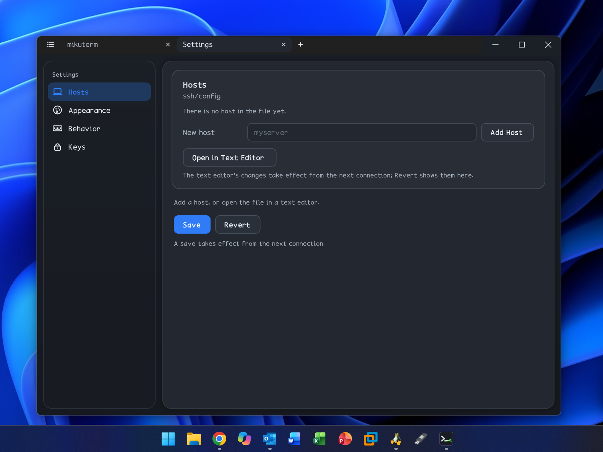
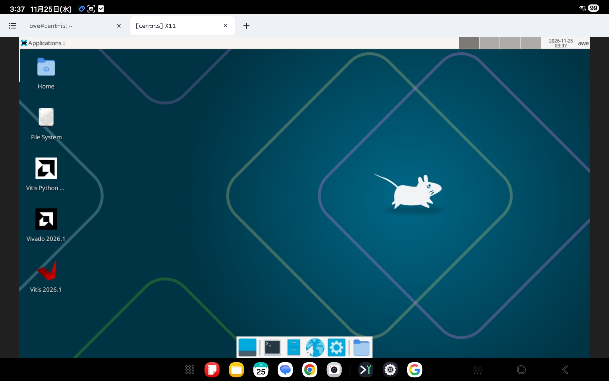
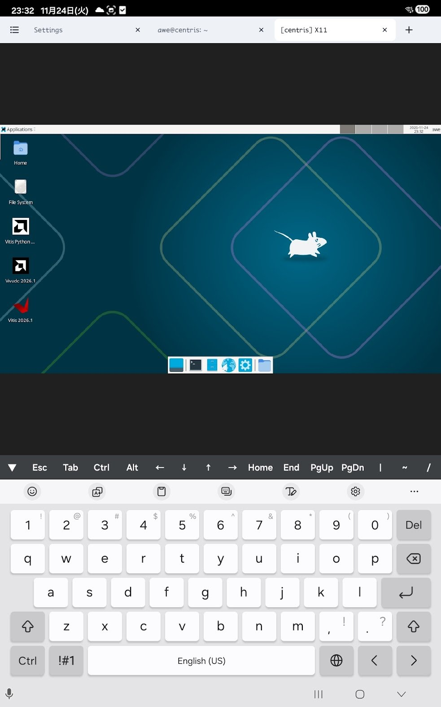
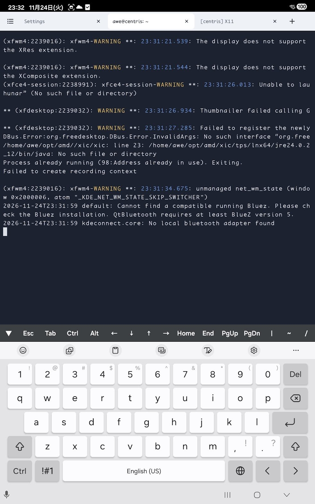
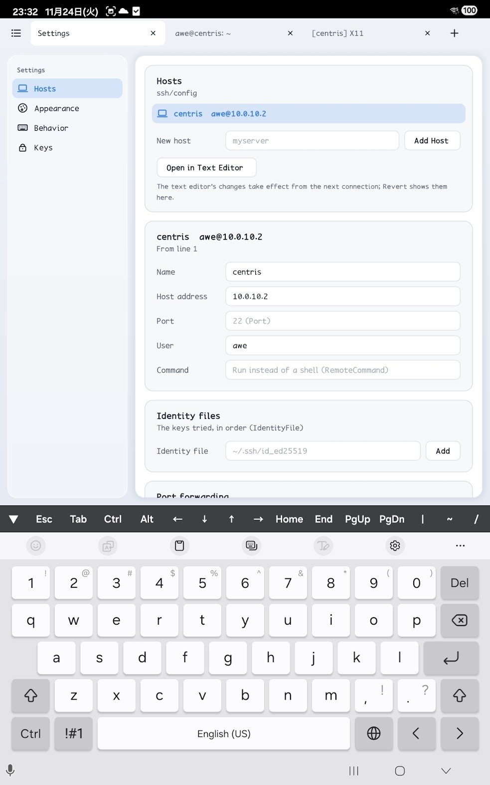
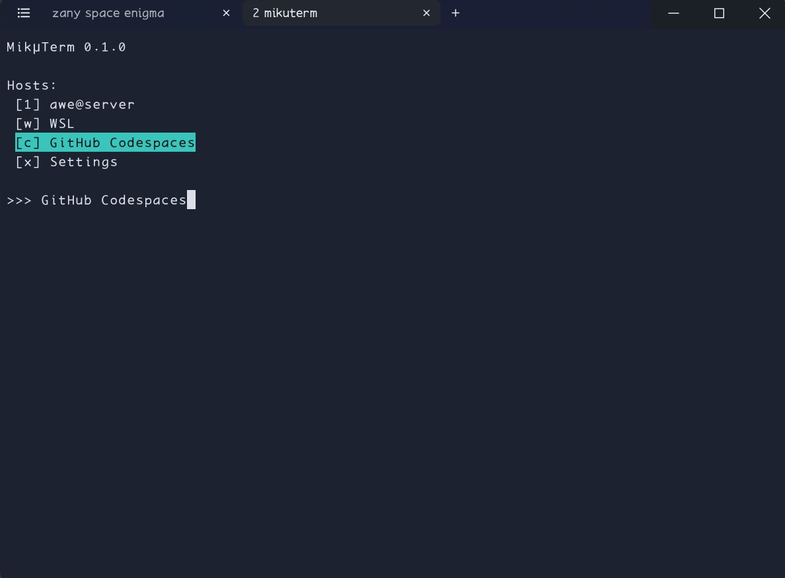
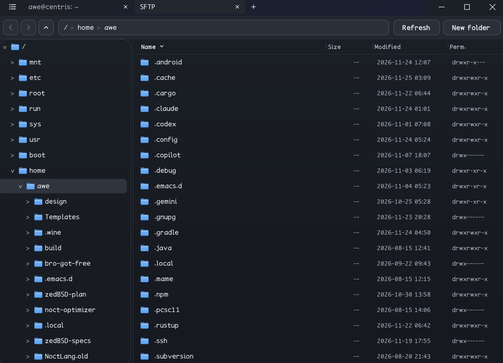

mikuterm
========

`mikuterm` (Micro Unicode Terminal) is an SSH terminal for Windows,
featuring a Vulkan-accelerated rendering and an X11 forwarding server.

   
  

   
  

   
  

   
  

   
  

   
  

   
  

   

 
